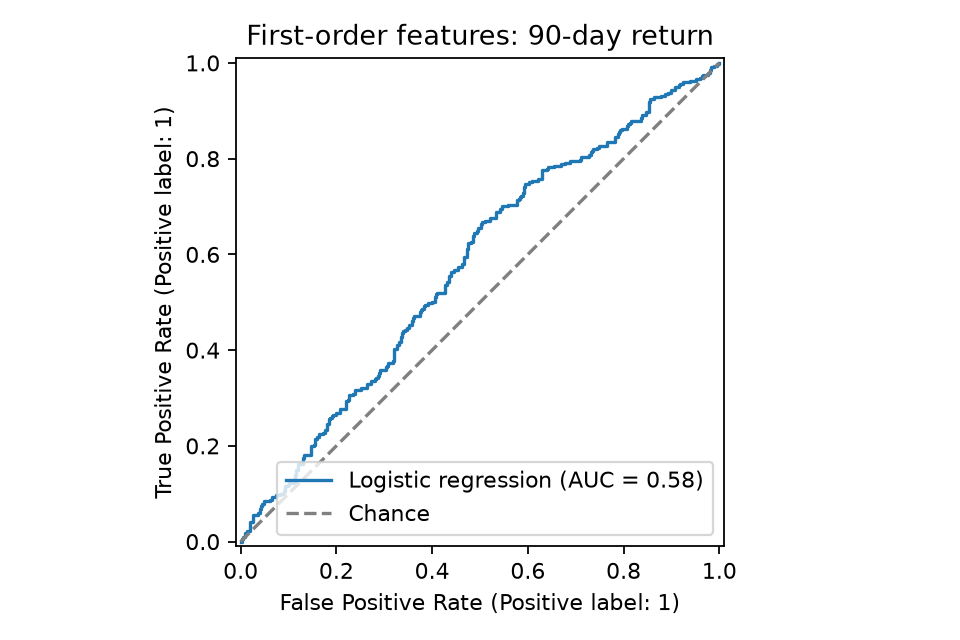

# Customer retention: a 90-day return analysis

A SQL and Python case study asking: **who returns within 90 days of their first observed purchase, and how much can the first order tell us?**

The project joins data preparation, an explicitly defined observation window, a simple machine-learning baseline, and an honest assessment of usefulness. It uses public UCI Online Retail data, not employer or client records.

## Main finding

Of 3,370 customers with a full 90-day observation window, 1,605 returned within 90 days: **47.63%**. The current local reproduction gives **53.41% accuracy**, versus **52.37%** for always predicting no return, **ROC AUC 0.576**, and **18.07% recall** for returning customers. The three first-order features provide weak predictive signal and miss most returners at the default threshold. That is not a useful deployment result.

Previously reported showcase metrics were 54.01% accuracy and AUC 0.546; the source presentation notebook did not retain its model outputs. These are historical reports, not the results of the current reproduction.

The current reproducible local run is saved in [reports/metrics.json](reports/metrics.json), with [confusion matrix](reports/confusion_matrix.png) and [ROC curve](reports/roc_curve.png). It uses deterministic customer ordering. The original SQL did not specify its final row order, so the original 674-customer holdout cannot be reconstructed exactly from its seed alone. This repository separates the historical showcase numbers from newly executed results.

## Workflow

1. Keep customer IDs that are present, positive quantities, and positive unit prices: 397,884 product rows from 541,909 raw rows.
2. Group by customer and invoice, using each invoice's earliest timestamp. Do not mistake multiple product lines for repeat purchases.
3. Select each customer's first observed order and next distinct invoice. Require the full 90 days of follow-up, including customers who never return.
4. Use only first-order value, total quantity, and distinct products as predictors. Later order dates and customer identifiers do not enter the model.
5. Use an 80/20 stratified historical holdout, seed 42. Fit StandardScaler only on the training set inside the logistic-regression pipeline. Compare with a most-frequent-class baseline.

## Run locally

Tested with Python 3.13.2. From this repository's root:

```bash
python -m venv .venv
# Activate .venv using your shell's normal command.
python -m pip install -r requirements.txt
python -m unittest discover -s tests -v
```

Download **Online Retail.xlsx** from [UCI](https://archive.ics.uci.edu/dataset/352/online+retail) and place it in `data/raw/`. Then:

```bash
python -m src.retention --input "data/raw/Online Retail.xlsx" --export-data
```

This runs the original workflow locally, writes aggregate metrics/charts to `reports/`, and writes ignored purchase/customer CSVs to `data/processed/`. It needs no Snowflake account or credentials. The full workbook run is separate from the small synthetic unit tests.

For a notebook walkthrough, open `notebooks/01_data_preparation.ipynb` then `notebooks/02_model_evaluation.ipynb` in a Python/Jupyter environment. The notebooks contain the original preparation/model steps with portable paths; the second reads the exported model data. Notebook execution requires a Jupyter kernel in addition to the CLI requirements.

For the SQL route, see [sql/README.md](sql/README.md). It uses Snowflake window functions and QUALIFY to produce the same customer-level table.

## Reading the results



- **First observed is not first-ever.** The dataset begins in December 2010, so existing customers can appear new to the observation window.
- **Return is not churn.** No observed second purchase in 90 days does not establish that a customer permanently left.
- **Historical holdout is not future validation.** This random split does not establish performance on a later period or a different retailer.
- **Scope matters.** The retailer is UK-based; this analysis keeps customers across all recorded countries. Missing customer IDs, refunds/negative quantities, and zero-price rows are excluded. Exact duplicate source lines are retained to preserve the original method, which can affect order-value and quantity features.
- **Threshold is fixed at 0.5.** Do not optimize a model or threshold on this test set. Further work would need training-only validation and an independently evaluated decision rule.
- **No deployment recommendation.** There is no causal claim, marketing uplift, financial return, or production-readiness claim.

## Repository guide

- `notebooks/`: cleaned presentation walkthroughs.
- `sql/`: original Snowflake feature/label logic with explicit final ordering.
- `src/`: local reproduction and model evaluation.
- `tests/`: synthetic checks of cleaning, invoice grain, mature windows, no-return cases, and deterministic ties.
- `reports/`: aggregate metrics and charts from the current local run.
- `docs/provenance.md`: contributions, data attribution, and changes made during packaging.

## Verification

The full local workbook run reproduced the cohort and generated the committed aggregate report. All 10 synthetic unit tests also passed with the pinned dependencies on Python 3.12.14 during the publication check. Synthetic tests cover boundary cases and reproducible evaluation. Notebook Python cells were checked in order separately; this is not a Jupyter or live Snowflake runtime check. GitHub Actions runs the synthetic unit tests; full-workbook and notebook execution remain separate checks.

## Data attribution and contributions

Chen, D. (2015). *Online Retail* [Dataset]. UCI Machine Learning Repository. https://doi.org/10.24432/C5BW33 . [CC BY 4.0](https://creativecommons.org/licenses/by/4.0/).

Independent project by Benjamin Buckland, with AI-assisted coaching, presentation refinement, and repository packaging. See [provenance](docs/provenance.md). No proprietary employer material or course assignment content is included. A code license has not been selected.
